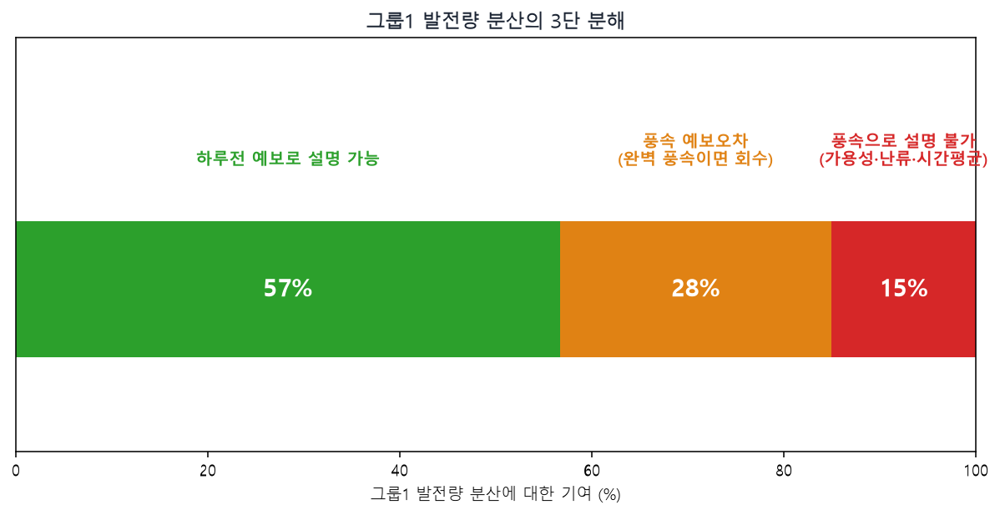
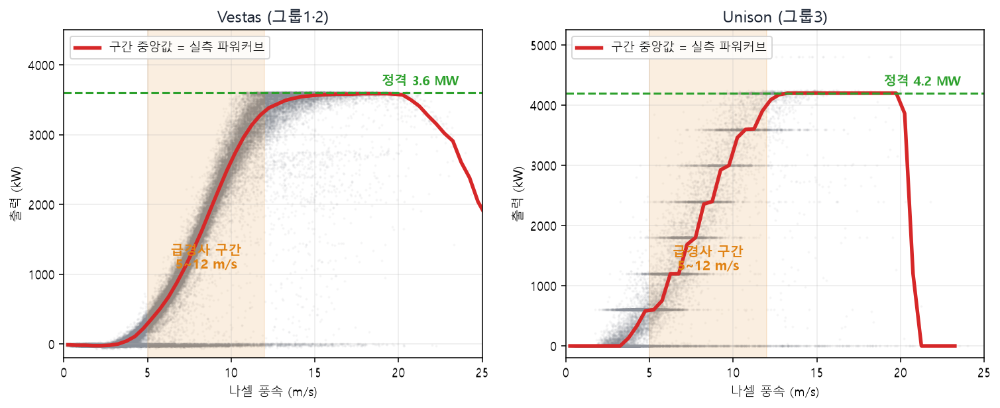
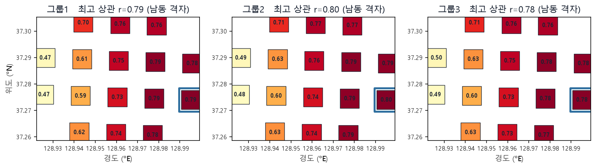
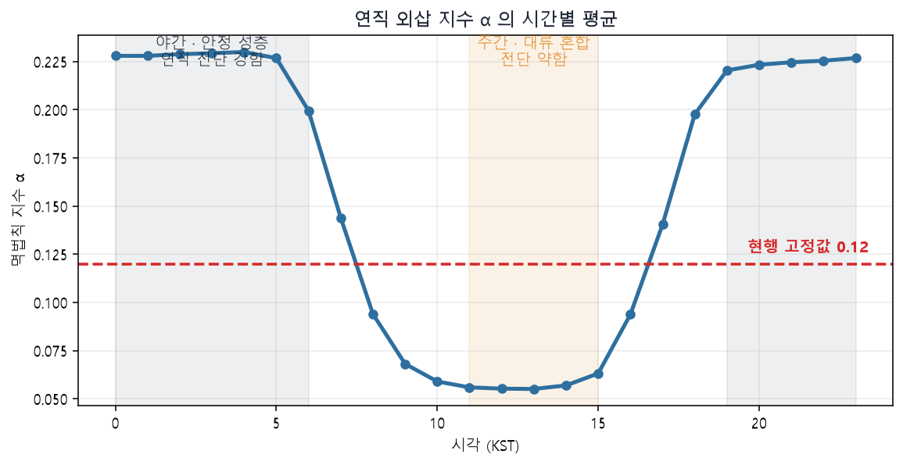
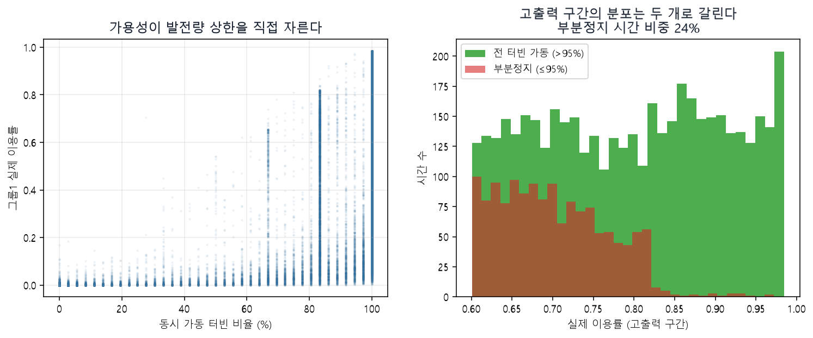
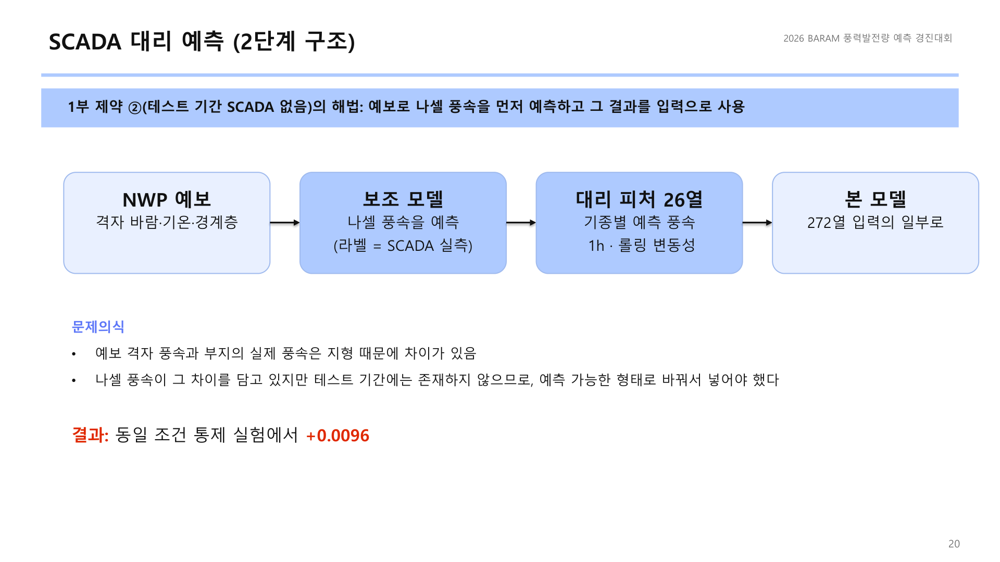
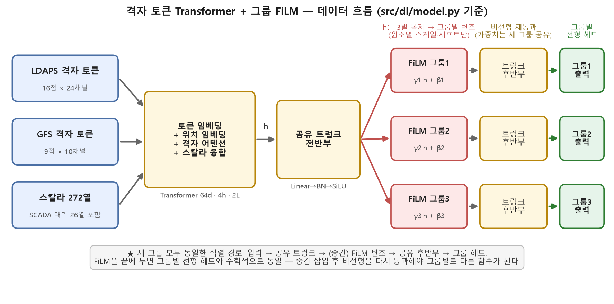
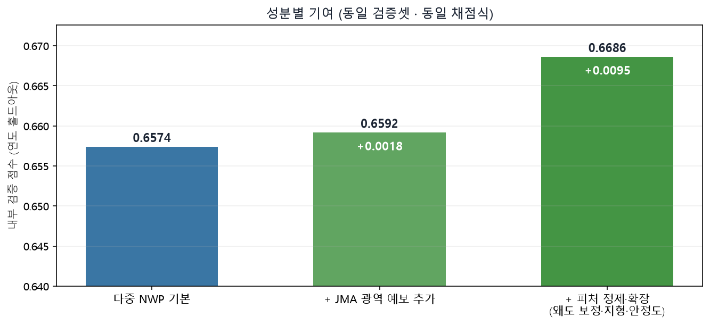

# 복잡지형 풍력단지 하루 전 발전량 예측 — 2026 BARAM 경진대회

> 태백 복잡지형 풍력단지 3개 그룹의 시간별 발전량을 **하루 전(D-1 14:00)** 에 예측하는 문제.
> 모든 설계 선택을 데이터 분석에서 도출한 엔드투엔드 파이프라인으로 **Public LB 0.672633 / Private 0.656899**, 본선(발표 평가) 진출.

| 항목 | 내용 |
|---|---|
| 대회 | 2026 BARAM 풍력발전량 예측 경진대회 (본선 발표 평가 진출) |
| 과제 | KPX 3개 그룹의 2025년 전체 시간별 발전량 예측 (하루 전 기준) |
| 채점 | ½(1-NMAE) + ½FICR(정산금 획득률) — 오차 6%/8% 계단형 정산 단가 |
| 성과 | **Public 0.672633 · Private 0.656899** |
| 역할 | 단독 참가 — 데이터 분석 · 피처 설계 · 모델링 · 검증 · 발표 전 과정 |
| 스택 | Python, PyTorch, pandas/numpy, LightGBM(비교 실험), matplotlib |

발표 자료: [`docs/BARAM2026_발표.pdf`](docs/BARAM2026_발표.pdf) · **기술 아키텍처 상세: [`docs/ARCHITECTURE.md`](docs/ARCHITECTURE.md)** · 재현 가이드: [`docs/REPRODUCING.md`](docs/REPRODUCING.md)

---

## 1. 문제가 어려운 세 가지 이유 (데이터로 정량화)

| 제약 | 측정값 | 대응 |
|---|---|---|
| 정산 허용창이 풍속 ±0.49 m/s에 불과 (실측 파워커브 최대 기울기 582 kW/(m/s)) — 예보 풍속 오차는 실측 1.87 m/s | 창이 오차보다 4배 좁음 | 허브 풍속 추정에 자원 집중 |
| 테스트 기간에 SCADA(나셀 풍속·터빈 상태) 부재 | 부지 실제 풍속 사용 불가 | **SCADA 대리 예측** (보조 모델) |
| 터빈 일부가 멈춘 부분가동 시간 47% | 같은 바람에도 발전량이 이봉 분포 | **정산 정렬 손실** 설계 |

### 오차 요인 분해 — 자원 배분의 근거

예보 풍속 / 실측 풍속 / 실제 발전량의 3단 비교로 분산을 분해:
**57%** 는 현재 예보로 설명, **28%p** 는 풍속 예보를 개선하면 회수 가능, **15%** 는 가용성·난류 등 예보로 줄일 수 없는 영역.
→ 자원을 28%p(풍속 추정)에 집중하고, 15%는 손실 함수 설계로 대응.



---

## 2. 데이터 분석 → 설계 결정 (분석 하나하나가 피처가 됨)

### 실측 파워커브 — 두 기종의 거동 차이
SCADA에서 직접 적합한 파워커브. Vestas(그룹1·2)는 매끈한 S자, Unison(그룹3)은 계단형 제어 + 즉시 정지형 컷아웃 → 그룹별 분화(FiLM)의 근거.



### 격자별 공간 상관 — "가까운 격자"가 아니라 "주풍향 상류"
LDAPS 격자 16점별 풍속-발전량 상관: 남동쪽 0.8 vs 서쪽 0.5. 세 그룹 동일 패턴 → 격자 하나를 고르는 대신 **16점 전체를 위치 좌표와 함께 입력**하고 가중은 모델이 학습.



### 연직 외삽 지수의 일주기 — 고정 지수는 야간 풍속을 놓친다
예보(10/50m)를 허브(117m)로 외삽하는 멱법칙 지수 α를 안정도(리처드슨 수·경계층고·복사)로 추정: 밤 0.23 / 낮 0.055로 4배 변동, 전환 시각이 일출·일몰과 일치 → 안정도 조건부 풍속을 피처로 추가.



### 가용성 이봉 분포 — 어떤 모델도 원리적으로 맞힐 수 없는 구간
고출력 시간의 24%가 부분정지. 같은 바람 입력에서 실제 발전량이 두 봉우리로 갈리는데, 원인(정비)은 예보에 없는 정보 → 예측 정확도가 아니라 **손실 함수가 "어느 봉우리에 설지"를 결정**해야 하는 문제로 재정의.



---

## 3. 모델링

### 핵심 아이디어 ① SCADA 대리 예측 (+0.0096, 동일 조건 통제 실험)
나셀 풍속은 지형이 만든 격자-부지 풍속 차이를 담지만 테스트 기간엔 없다 →
**예보만으로 나셀 풍속을 맞히는 보조 모델을 먼저 학습**하고, 그 예측 26열을 본 모델 입력으로 주입.
입력은 전부 사전 공개 예보, 라벨은 학습 기간에만 사용 — 누수 없음.



### 핵심 아이디어 ② 격자 토큰 Transformer + 그룹 FiLM
후보 계열을 동일 검증셋 통제 실험으로 전부 비교 후 채택:

| 후보 | 실측 | 판정 |
|---|---|---|
| 공간 CNN (격자를 이미지로) | **−0.0092** | 기각 — 격자는 고정 지리 위치, 위치마다 물리가 다른데 필터 공유를 강제 |
| GBDT (LightGBM 분위수) | +0.0001 | 기각 — 표로 펴면 공간 구조 소실 |
| 시퀀스 모델 (LSTM 계열) | — | 기각 — 부분정지가 연속성 가정을 깸 |
| 분포 출력 헤드 | −0.033 | 기각 — 연도 간 분포 이동으로 전이 실패 |
| **격자 토큰 Transformer + FiLM** | ★채택 | 위치 임베딩이 지형 고유성 보존, 어텐션이 풍향 따라 참조 격자 변경 |

구조: LDAPS 격자 토큰(16점×24ch) + GFS 격자 토큰(9점×10ch) + 스칼라 272열 → 공유 트렁크(Transformer 64·4h·2L, 중간에 그룹별 FiLM 변조) → 3그룹 동시 출력.
앙상블: 구성 3종 × 시간창(±6h) × 시드(유형당 16개), 그룹3는 MAE 방식 자기지도 사전학습.



> 토큰화·FiLM 삽입 위치·손실 유도·앙상블 레시피의 전체 상세는 **[`docs/ARCHITECTURE.md`](docs/ARCHITECTURE.md)** 참조.

### 핵심 아이디어 ③ 정산 정렬 손실
정산 단가 계단(6%→4원, 8%→3원, 밖 0원)을 시그모이드 2개의 가중합으로 평활 근사해 손실에 직접 반영:

```
L = (1-w)·nMAE + w·(1-softFICR) + λ·bias²   (w=0.5, 0.2~0.9 사다리 검증)
```

- 평활폭 어닐링(초기 넓게→후기 좁게), 회수 불가능한 대오차(>15%)는 기울기 차단
- bias² 항은 특정 방향 쏠림을 벌점화해 교차연도 전이 안전성 확보

### 성분별 기여 (동일 검증셋·공식 채점식)
다중 NWP 기본 0.6574 → +JMA 외부 예보 0.6592 → +피처 정제·확장 **0.6686**.
지형이 가장 복잡한 그룹3가 +0.020으로 최대 개선 — **오차 분해가 가리킨 곳에서 개선이 나옴**.



---

## 4. 검증 프로토콜 — 리더보드 과적합을 막은 장치

| 규칙 | 내용 |
|---|---|
| 분할 | 연도 단위 홀드아웃 (2022/23/24) — 실전 과제("본 적 없는 해 예측")와 동일 구조 |
| 비교 | 동일 시드·설정의 통제쌍만 인정 |
| 노이즈 | **짝지은 부트스트랩** — 공통 난이도 상쇄로 판정 분산 6.5배 축소 |
| 판정 | 차이 0.002 미만은 무판정 (소음에 반응하지 않음) |

확인한 한계: 연도마다 P(발전량|풍속)이 달라 **과거 분포에 맞춘 사후 보정은 전이 실패**, 입력 확장·물리 피처·손실 정렬만 생존 → 원칙: *물리는 과거로, 분포는 조심스럽게.*

---

## 5. 재현성

- 최종 조립(`inference.py`)을 **완전 결정적 경로**(난수·GPU 없음)로 설계 — 최종 제출 파일이 `inference.py` 한 줄로 **오차 0(비트 일치)** 재현됨을 실행 로그로 확인
- 외부 데이터는 전량 대상일 이틀 전(D-2) 발표분만 사용, 공개 시각을 메타데이터로 직접 검증 — 회색지대 소스 2건은 자진 폐기 ([`docs/EXTERNAL_DATA.md`](docs/EXTERNAL_DATA.md))
- 파이프라인·환경·결정성 설계: [`docs/REPRODUCING.md`](docs/REPRODUCING.md)

## 저장소 구성

```
src/            # 피처 엔지니어링 · DL 모델 (격자 토큰 Transformer, FiLM, 손실)
  dl/model.py   #   아키텍처 + 정산 정렬 손실 구현
  dl/train_dl.py#   학습 레시피 (멤버 구성·시드·SSL)
  dl/mae.py     #   그룹3 자기지도 사전학습
train.py        # 학습 진입점
inference.py    # 추론 진입점 (최종 조립, 완전 결정적)
analysis/       # EDA·물리 분석 코드 (발표 figure 생성)
scripts/        # 외부 데이터 수집 스크립트
docs/           # 발표 자료(PDF) · ARCHITECTURE.md · REPRODUCING.md · EXTERNAL_DATA.md
assets/         # 분석 figure · 구조 다이어그램
```

> 대회 데이터와 학습된 가중치는 대회 규정상 재배포할 수 없어 저장소에는 코드와 문서만 담았습니다. 전체 파이프라인의 동작 방식은 [`docs/ARCHITECTURE.md`](docs/ARCHITECTURE.md)와 [`docs/REPRODUCING.md`](docs/REPRODUCING.md)에서 확인할 수 있습니다.
