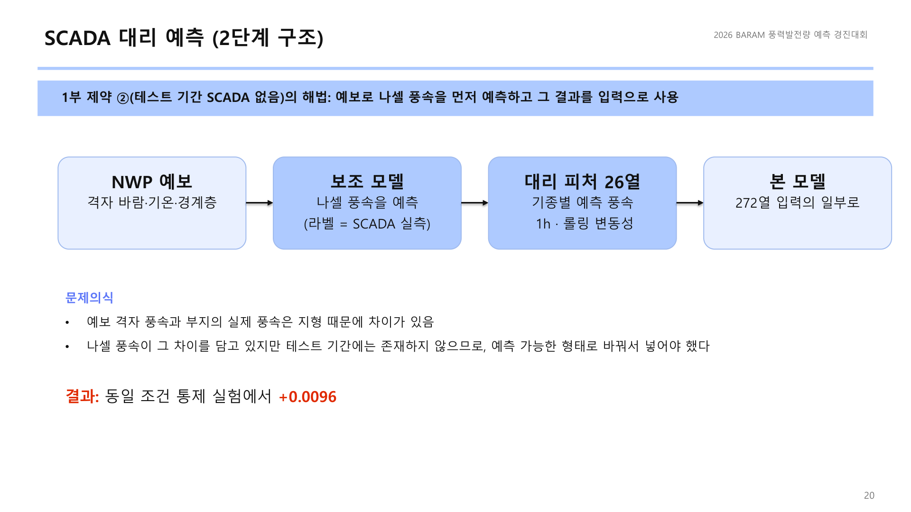
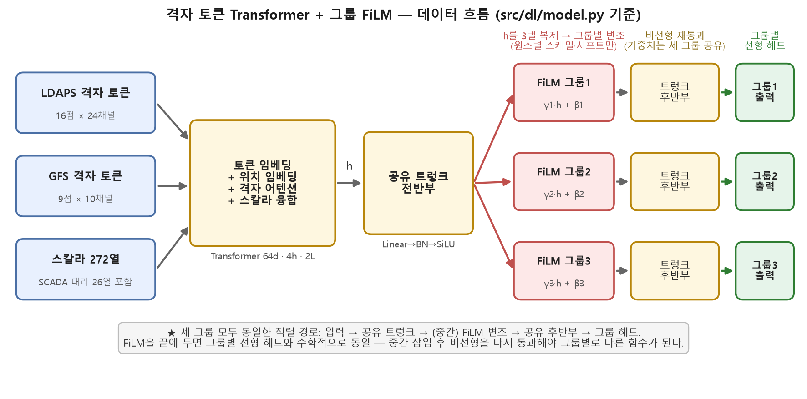

# 기술 아키텍처 상세

최종 모델의 입력 표현부터 손실 함수, 앙상블, 검증까지의 전체 설계 문서.
코드 기준: [`src/dl/model.py`](../src/dl/model.py) (아키텍처·손실), [`src/dl/train_dl.py`](../src/dl/train_dl.py) (학습 레시피), [`src/dl/mae.py`](../src/dl/mae.py) (SSL), [`src/features.py`](../src/features.py) (피처).

---

## 1. 전체 파이프라인


설계 원칙: **모든 구성요소는 데이터 분석의 발견 하나에 대응**한다. 어텐션은 격자가 고정된 지리 위치이기 때문에, 그룹별 변조는 기종 차이 때문에, 손실 구성은 정산 단가 구조 때문에 선택했다.

---

## 2. 입력 표현

### 2.1 격자 토큰 (공간 구조 보존)

예보 데이터는 시각마다 격자점 단위로 제공된다 (LDAPS 16점, GFS 9점, 각 점에 위도·경도 부속).
흔한 처리(최근접 1점 선택, 평균으로 축약, 표로 평탄화)는 전부 공간 정보를 버린다 — 격자별 풍속-발전량 상관이 남동 0.8 vs 서쪽 0.5로 갈리는 데이터에서는 치명적이다.

| 입력 | 형태 | 내용 |
|---|---|---|
| LDAPS 격자 토큰 | 16점 × 24채널 | 풍속(10/50m)·기온·기압·경계층고·복사 등 + **위치 임베딩** |
| GFS 격자 토큰 | 9점 × 10채널 | 광역 종관 보완 (850hPa 바람 등), 독립 물리코어 |

각 격자점을 "신원(위치 임베딩)이 있는 토큰"으로 취급한다. 위치 임베딩이 지형 고유성(위치마다 다른 물리)을 보존하고, 어텐션이 시점별로 풍향에 따라 참조 격자를 바꾼다.

### 2.2 스칼라 272열 (도메인 파생변수)

기본 86열 + 도메인 파생 186열. 모든 가족에 데이터 분석에서 나온 이유가 있다:

| 피처 가족 (열수) | 근거가 된 분석 |
|---|---|
| 격자 공간통계 (39) | 남동-서 상관차 0.3 — 격자 간 기울기·산포가 유입 경로를 담음 |
| 파워커브 변환 (33) | 커브 급경사 — 풍속을 기대 이용률·민감도·불확실폭으로 번역 (타깃 상관 0.91 vs 원시 풍속 0.76) |
| SCADA 대리예측 (26) | 격자 바람 ≠ 부지 체감 바람 — §3 참조 |
| JMA 예보 (20) | 독립 물리코어의 탈상관 오차 — 나셀 풍속 MAE 7.3% 개선 |
| 그룹별 격자 추출 (16) · 광역 15지점 (15) | 그룹 조건부 대표값 · 종관 유입의 상류 선행 신호 |
| 물리 위상 (14) · 기타 (14) · wake (9) | 연직 외삽 일주기(α 밤 0.23/낮 0.055)·계절 위상 · 경계층 맥락 · 터빈 배치 기하 |

이 중 54열은 3·6·24시간 롤링 통계 — 출력 급변과 전선 통과는 한 시각의 값만으로는 잡히지 않기 때문.
근중복(상관 ≥0.98) 피처는 제거했고, 남긴 피처들이 서로 다른 정보축임을 상호 상관으로 확인했다.

---

## 3. SCADA 대리 예측 (2단계 구조)

**문제**: 나셀 풍속은 지형이 만든 격자-부지 풍속 차이를 담는 최고의 신호지만, 테스트 기간에는 존재하지 않는다.

**해법**: 없는 값을 예측해서 넣는다.



1. **보조 모델**: 입력 = 예보(격자 바람·기온·경계층), 라벨 = SCADA 나셀 풍속 실측 (학습 기간에만 존재)
2. **대리 피처 26열**: 기종별 예측 나셀 풍속(1h) + 롤링 변동성
3. **본 모델**: 대리 피처를 272열 스칼라의 일부로 주입

**누수 없음**: 보조 모델의 입력은 전부 사전 공개 예보이고, 나셀 라벨은 학습 기간에만 사용된다. 테스트 기간에는 보조 모델의 예측값만 들어간다.
**효과**: 동일 조건 통제 실험에서 **+0.0096** (이 프로젝트 단일 아이디어 중 최대 기여).

---

## 4. 본 모델: 격자 토큰 Transformer + 그룹 FiLM



### 4.1 데이터 흐름

```
LDAPS 토큰(16×24) ─┐
GFS 토큰(9×10) ────┼→ 공유 트렁크 전반부 ─→ 그룹별 FiLM 변조 ─→ 트렁크 후반부 ─→ 그룹1/2/3 출력
스칼라 272열 ──────┘   (Transformer 64d·4h·2L,        (γ_g·h + β_g,          (비선형 통과)
                        격자 어텐션 + 스칼라 융합)       그룹당 3벌 분화)
```

- **트렁크는 세 그룹이 공유** — 바람의 물리는 공통이므로 3그룹 데이터를 한 몸통이 전부 사용 (데이터 효율 3배)
- **FiLM은 트렁크 중간에 삽입** — 끝에 붙이면 그룹별 선형 헤드와 수학적으로 동일해 이득이 없다 (`model.py` 주석 참조). 중간 삽입 후 비선형을 다시 통과해야 그룹별로 진짜 다른 함수가 된다
- FiLM 파라미터는 그룹당 γ·β(원소별 스케일+시프트)뿐 — **그룹 차이에 할당된 용량을 의도적으로 최소화** (차이는 얇게, 공통은 두껍게)
- 모델이 작은 것(64차원·2층)은 의도: 학습 데이터 3년치에 맞춘 용량. 다양성은 앙상블이 담당

### 4.2 모델 계열 선택 (동일 검증셋 통제 실험)

| 후보 | 실측 | 기각/채택 사유 |
|---|---|---|
| 공간 CNN (격자를 이미지로) | **−0.0092** | 격자는 고정 지리 위치. 위치마다 물리가 다른데 필터 공유 강제 |
| GBDT (LightGBM 분위수) | +0.0001 | 공간 구조를 표로 펴면 위치 관계 소실 (무판정 → 구조 보존 쪽 선택) |
| 시퀀스 모델 (LSTM 계열) | 세대 교체 | 부분정지 47%가 시계열 연속성 가정을 깸 |
| 분포 출력 헤드 | −0.033 | 연도 간 분포 이동으로 과거 분포 형태가 전이되지 않음 |
| **격자 토큰 Transformer + FiLM** | ★ 채택 | 위치 임베딩이 지형 고유성 보존, 어텐션이 풍향 따라 참조 격자 변경 |

---

## 5. 손실 함수: 정산 정렬 손실

대회 채점은 ½(1-NMAE) + ½FICR. FICR의 정산 단가는 오차 6% 이내 4원, 8% 이내 3원, 밖 0원의 **계단** — 계단은 기울기가 0이라 그대로는 학습 신호가 없다.

```
L = (1-w)·nMAE + w·(1-softFICR) + λ·bias²        (w = 0.50, λ = 0.05)
```

| 항 | 구현 | 이유 |
|---|---|---|
| nMAE | 채점 규정과 동일한 대상 시간(실발전 ≥ 설비용량 10%)의 평균 절대 오차 | 전 구간 정확도의 기본기, 채점식 미러 |
| softFICR | `s8 = σ((0.08−e)/τ)`, `s6 = σ((0.06−e)/τ)`, 단가 ≈ `3·s8 + s6`, 발전량(kWh) 가중 합산 ÷ 만점 | 시그모이드 2개의 1:3 가중합이 4/3/0원 계단을 미분 가능하게 재현 |
| 평활폭 τ 어닐링 | 학습 초기 넓게 → 후기 좁게 | 초기 안정성(먼 예측에도 신호)과 후기 경계 민감성의 양립. 최종 최적화 대상은 실제 계단에 수렴 |
| 대오차 차단 | \|e\| > 15%는 정산 항 기울기 0 | 오차 분해상 예보로 도달 불가한 15%에 학습 용량을 쓰지 않음 |
| λ·bias² | 그룹별 부호 보존 평균 오차의 제곱 벌점 | 정산 항이 보상할 수 있는 체계적 쏠림은 검증 연도 분포에 과적합된 것 — 교차연도 안전핀 |

- w는 0.2~0.9 사다리 실험으로 검증: 0.5~0.8 평탄, 밖은 정확도 훼손으로 총점 하락 → 0.5 채택
- **soft는 학습(기울기)에만 사용** — 모델 평가·선택은 전부 공식 계단 채점식(hard)으로 수행 (분류의 정확도/크로스엔트로피와 같은 표준 대리손실 구도)
- 공식 지표가 그룹 매크로 평균임에 맞춰 손실도 그룹별 계산 후 평균 (pooled 시 그룹3 이중 과소가중)

---

## 6. 멤버 앙상블

같은 설정도 난수 초기값·배치 순서에 따라 다른 모델이 되는 **학습 노이즈**를 평균으로 상쇄한다. 계단 채점은 예측의 작은 흔들림을 점수로 증폭하므로 분산 축소의 가치가 크다.

| 축 | 구성 | 다양성의 원천 |
|---|---|---|
| 구성 3종 | `v2_gated_attn`(어텐션 풀링+게이트) / `v2_base`(평균 풀링) / `v1_attn`(이전 데이터 세대+어텐션) | 격자 토큰 정보를 요약하는 방식 |
| 시간창 | no-window 3종 + window 3종 (예보 오프셋 **±6h**, 13시점, win_dim 48) | 대상 시각만 보기 vs 전선 통과·램프의 시간 맥락까지 보기 |
| 시드 | 멤버 유형당 16 시드 (그룹1·2 = 6유형 × 16 = 96 네트워크) | 학습 노이즈 상쇄 |
| 그룹3 SSL | MAE 방식 사전학습 (mask 60%, 100 epoch) 후 미세조정, 10 시드 | 데이터 최소·지형 최난 그룹의 라벨 없는 선행학습 |

- 멤버는 64차원·2층 초소형 — "앙상블 전제의 경량 멤버"가 설계 방침 (전체 비용 < 대형 단일 모델)
- 멤버 수는 개선이 무판정 영역(0.002)에 들어가는 한계효용 지점에서 중단
- 시드 골라잡기(best-seed picking)는 검증셋 과적합이므로 의도적으로 배제 — 시드는 선택이 아니라 평균의 대상

---

## 7. 검증 프로토콜

| 규칙 | 내용 |
|---|---|
| 분할 | **연도 단위 홀드아웃** (2022/23/24 각각을 통째로 시험지로) — 실전 과제 "본 적 없는 해 예측"과 동일 구조. 시간 무작위 분할은 인접 시각 누수로 금지 |
| 비교 | 동일 시드·설정의 **통제쌍**만 인정 — 아이디어 하나만 바꿔 효과를 귀속 |
| 노이즈 | **짝지은 부트스트랩** — 두 모델을 같은 시간 표본으로 채점해 공통 난이도(폭풍일 등)를 차이에서 상쇄. 판정 분산 6.5배 축소 |
| 판정 | 차이 0.002 미만 무판정 — 우연과 구분되지 않는 차이로 결정하지 않음 |

**확인한 한계**: 연도마다 P(발전량\|풍속)이 달라 과거 분포에 맞춘 사후 보정은 전이 실패. 입력 확장·물리 피처·손실 정렬만 생존 → *물리는 과거로, 분포는 조심스럽게.*

성분별 기여 (동일 검증셋, 공식 채점식): 다중 NWP 기본 0.6574 → +JMA 0.6592 → +피처 정제·확장 **0.6686**. 그룹별 최대 개선은 지형 최난 그룹3 (+0.020) — 오차 분해가 가리킨 곳에서 개선이 나왔다.

---

## 8. 재현

```bash
python inference.py --root <저장소루트> --out submission_final.csv   # 제출 파일 오차 0 복원, GPU·난수 불필요
python train.py                                                      # 학습부터 재현 (레시피 고정)
```

상세 절차·환경·결정성: [`REPRODUCING.md`](REPRODUCING.md) · 외부 데이터 출처·합법성: [`EXTERNAL_DATA.md`](EXTERNAL_DATA.md)
